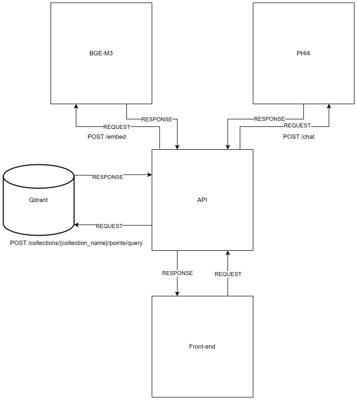

# M.A.I.A.

A retrieval-augmented chatbot that answers questions about the city of Liberec using
the city's own published data, running entirely on self-hosted models.

Built at Liberec Ideathon 2025, where it received a wild card for an outstanding solution.



## How it works

The pipeline has four stages and no external AI provider is involved at any point.

1. **Scraping.** `URLsScraper.py` walks the city's public sites and collects page
   addresses. `WebContentScraper.py` then pulls the text of each page.
2. **Embedding.** Scraped text is embedded with **BGE-M3** and stored in **Qdrant**.
3. **Retrieval.** A user question is embedded with the same model and used to query
   Qdrant. The closest passages are attached to the request as `system` messages.
4. **Generation.** **Phi-4** answers using only those passages, so the answer stays
   tied to what the city actually published.

Using one model for both sides of the retrieval matters: the question and the documents
land in the same vector space, so a question phrased differently from the source page
still finds it.

## Architecture

| Part | Stack |
|---|---|
| API | ASP.NET Core (C#), `ChatBotController` |
| Scrapers | Python |
| Vector database | Qdrant |
| Embedding model | BGE-M3 |
| Language model | Phi-4, served through Ollama (`model_files/Modelfile`) |
| Client | Next.js, TypeScript, Tailwind CSS |
| Deployment | Docker Compose, separate CPU / NVIDIA / AMD variants |

## Running it

Everything runs in containers. Pick the file that matches your hardware.

```shell
# CPU only
docker compose up -d

# NVIDIA GPU (needs the NVIDIA Container Toolkit, see below)
docker compose -f docker-compose-nvidia-gpu.yml up -d

# AMD GPU
docker compose -f docker-compose-amd-gpu.yml up -d
```

The models are large. The first start pulls them and takes a while.

### NVIDIA Container Toolkit

Only needed for the NVIDIA variant.

```shell
# Debian / Ubuntu
curl -fsSL https://nvidia.github.io/libnvidia-container/gpgkey \
    | sudo gpg --dearmor -o /usr/share/keyrings/nvidia-container-toolkit-keyring.gpg
curl -s -L https://nvidia.github.io/libnvidia-container/stable/deb/nvidia-container-toolkit.list \
    | sed 's#deb https://#deb [signed-by=/usr/share/keyrings/nvidia-container-toolkit-keyring.gpg] https://#g' \
    | sudo tee /etc/apt/sources.list.d/nvidia-container-toolkit.list
sudo apt-get update && sudo apt-get install -y nvidia-container-toolkit

# RHEL / Fedora
curl -s -L https://nvidia.github.io/libnvidia-container/stable/rpm/nvidia-container-toolkit.repo \
    | sudo tee /etc/yum.repos.d/nvidia-container-toolkit.repo
sudo yum install -y nvidia-container-toolkit
```

Then point Docker at the NVIDIA runtime and restart it:

```shell
sudo nvidia-ctk runtime configure --runtime=docker
sudo systemctl restart docker
```

Full instructions are in the
[NVIDIA documentation](https://docs.nvidia.com/datacenter/cloud-native/container-toolkit/latest/install-guide.html).

## Team

Built by a team of four at Liberec Ideathon 2025. I led the team, designed the
architecture and split the work.

## Licence

MIT, see [LICENSE](./LICENSE). The models it runs are licensed separately by their
authors: Phi-4 and BGE-M3 are both MIT, Qdrant is Apache 2.0.
